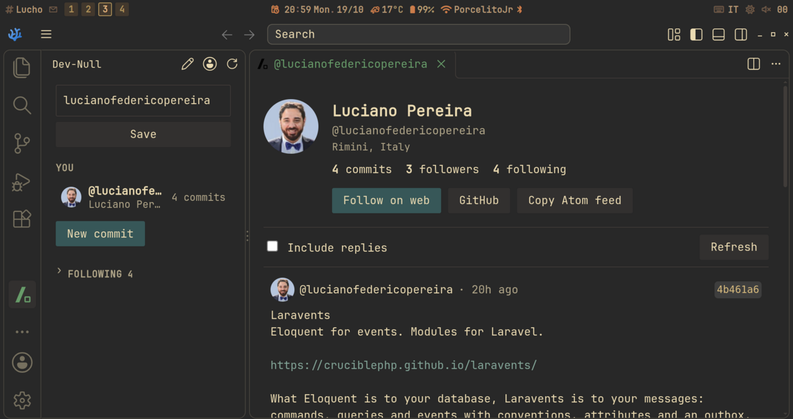

# vs-dev-null

Browse [dev-null.sh](https://dev-null.sh), the social network for developers, and commit to it without leaving VSCodium or VS Code.

- **Read**: open any profile and its commits in an editor tab, with link previews, images, code blocks and replies.
- **Follow along**: the dev-null sidebar shows your profile and the people you follow; one click opens their commits.
- **Commit**: write a commit, a reply or a commit with up to 3 images, from a composer next to your code. Select code, right-click, **Commit Selection**.



## Committing without a login

There's no token and no login. Like the official [`devnull commit`](https://dev-null.sh/commit) script, the extension:

1. Lists your public keys (`ssh-add -L` and `~/.ssh/*.pub`) and asks dev-null.sh which one is on your GitHub account.
2. Signs the commit locally with `ssh-keygen -Y sign` under the `devnull-commit` namespace (`devnull-commit-images` with images). The signature is only valid for dev-null.sh commits.
3. Sends the commit and the signature.

It never reads or sends private keys: your SSH agent or `ssh-keygen` uses them. If the key is passphrase-protected and not in your agent, the extension asks for the passphrase and pipes it to `ssh-keygen`. It's never stored.

You need an Ed25519 or RSA key on your GitHub account, and a dev-null.sh account.

## Requirements

- VSCodium or VS Code 1.96+
- `ssh-keygen` (OpenSSH 8.1+) to commit

## Commands

| Command | |
|---|---|
| `dev-null: Open Profile` | Open your profile, or the one given |
| `dev-null: Open Commit` | Open a commit by id or dev-null.sh link |
| `dev-null: New Commit` | Open the composer |
| `dev-null: Commit Selection` | Open the composer with the selected code |
| `dev-null: Set Username` | Focus the username field in the sidebar |

In the composer, `Ctrl+Enter` (`Cmd+Enter` on macOS) commits.

## Settings

| Setting | Default | |
|---|---|---|
| `devnull.username` | `""` | Your dev-null.sh username |
| `devnull.baseUrl` | `https://dev-null.sh` | Base URL of the dev-null.sh instance |

## Limits

- Reading uses the public dev-null.sh API, which allows 60 requests per minute and only returns approved commits.
- Following, starring, bookmarking and reading a commit's replies all need a device approved for the dev-null.sh mobile app, so those actions open the page on dev-null.sh instead.
- A new commit may be held for review before it shows up publicly. dev-null.sh says so in its answer.

This is a community extension. It isn't affiliated with dev-null.sh.

## Build

```bash
npm install
npm run build
npm run package
npm run install:codium   # package and install into VSCodium
```

## License

MIT © Luciano Federico Pereira
